# SpeedPulser Pro

The SpeedPulser Pro brings an OEM analogue speedometer back to life without a mechanical cable. It takes a vehicle speed signal — from a gearbox hall sensor, a [Can2Cluster](https://forbes-automotive.com) signal, a CAN bus (ECU / ABS / DSG / UDS) or a GPS module — and drives a small BLDC motor on the back of the speedo with a 10 kHz PWM signal. It can also read engine RPM (hall or CAN) and re-output it as a traditional coil-style ignition signal for a tachometer. It is fully open source, set up over WiFi, and calibrated per cluster so the needle reads accurately across the motor's speed range.

The current board is the **ESP32-S3** (ESP32-S3-WROOM-1-N16R8) V3 PCB: buck voltage control with rail read-back, motor feedback, a VR speed input and a switchable speed-input bias. The **ESP32 DevKit V1 (WROOM-32)** board is the legacy one: fixed motor supply set by its pot, PWM duty only. One codebase builds for both (`esp32-s3` and `esp32doit-devkit-v1` in `platformio.ini`), and both drive a **TY3816B** BLDC motor through a native LEDC hardware PWM channel. The PCB is an upgrade on the original SpeedPulser board, adding CAN, GPS and a coil-type RPM output.

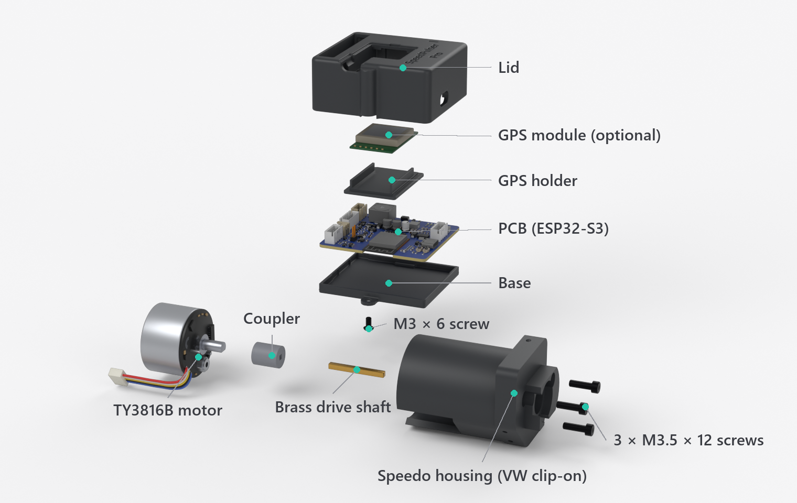

## Contents

- [Features](#features)
- [Supported Models](#supported-models)
- [Purchase](#purchase)
- [What's in the Box](#whats-in-the-box)
- [Installation](#installation)
  - [Installation Video](#installation-video)
  - [Wiring](#wiring)
  - [Fitting the Drive Shaft](#fitting-the-drive-shaft)
  - [Fitting to the Cluster](#fitting-to-the-cluster)
- [Setup (WiFi & Web Interface)](#setup-wifi--web-interface)
- [Calibration](#calibration)
- [GPS & Update Rates](#gps--update-rates)
- [CAN Bus](#can-bus)
- [Speed Offset](#speed-offset)
- [Over-the-Air Updates](#over-the-air-updates)
- [Feedback & Motor Voltage](#feedback--motor-voltage-s3)
- [How Calibration Works](#how-calibration-works)
- [Power Management](#power-management)
- [Technical Reference](#technical-reference)
- [Disclaimer](#disclaimer)
- [Version History](#version-history)

---

## Features

| Feature | Detail |
|---|---|
| Speed input | Hall, VR (S3), ECU (CAN), ABS (CAN), DSG (TP2.0), UDS (CAN), GPS, Custom CAN |
| RPM input | Hall (12 V square wave) or CAN |
| Speedometer output | 10 kHz hardware PWM, 12-bit resolution |
| RPM output | Coil-style square wave (hardware-timer driven) |
| CAN | 500 kbit/s TWAI, full RX/TX, broadcast & SavvyCAN forwarding |
| GPS | u-blox NMEA, 1 / 5 / 10 / 16 Hz user-selectable update rate |
| Voltage control *(S3)* | One **drive** value (motor rail volts × PWM) runs the motor; **Test Board** checks the rail at 5 / 7.5 / 10 V |
| Drive calibration *(S3)* | Capture the top mark by eye, **Auto Fill** measures the rest from the motor feedback (up to 20 marks, Restore Previous) |
| Closed-loop feedback *(S3)* | One slow trim on the calibrated drive holds the motor speed measured for each mark |
| Calibration profiles *(DevKit)* | 18 built-in (VW, Ford, Fiat, Merc, Smiths, Opel, VW Bay) |
| Calibration Builder *(DevKit)* | Custom calibration builder - no coding knowledge required |
| Calibration curve | Live duty-vs-speed curve with the current operating point on the Dashboard (DevKit); live control trace (S3) |
| WiFi UI | Web-app style interface |
| Needle sweep | Both needles (speed + RPM) on power-up, live-adjustable sweep speed |
| Speed offset | Global fixed offset **or** 5-point speed-dependent curve |
| OTA updates | Update from GitHub or by file upload on the OTA tab; Home WiFi bridge mode; recovery page if the web UI is ever lost |
| CAN analyser | Forward live frames to SavvyCAN via WiFi (GVRET) or Serial |
| Power management | WiFi off and CPU scaled down after 1 min idle |
| Remembers settings | All settings stored in ESP32 Preferences (NVS) |

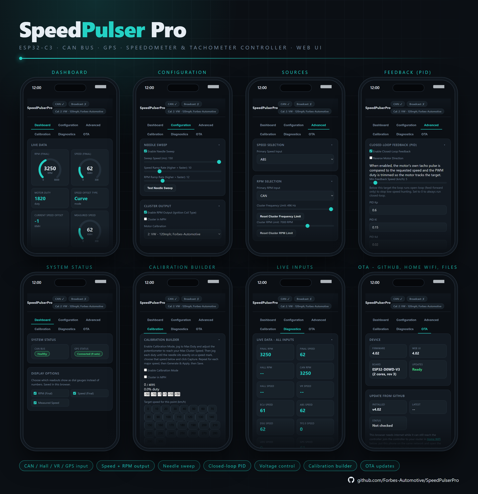

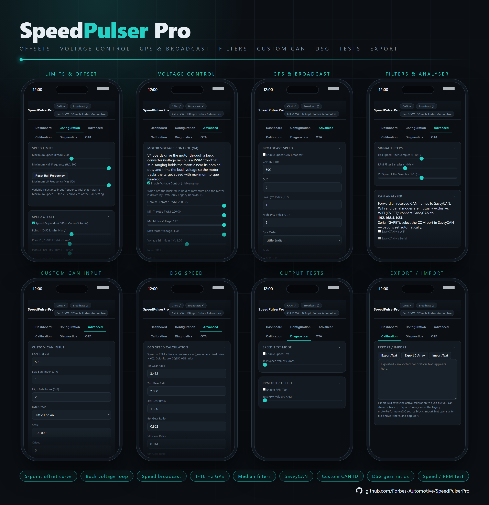

---

## Supported Models

| Cluster | Range | Calibration by |
|---|---|---|
| VW MK1 / MK2 Golf | 120 mph | Martin Springell |
| VW MK1 / MK2 Golf | 120 mph | Forbes Automotive |
| VW MK1 / MK2 Golf | 120 mph | Tara |
| VW MK1 / MK2 Golf | 140 mph | Forbes Automotive |
| VW MK1 / MK2 Golf | 160 mph | Forbes Automotive |
| VW MK1 / MK2 Golf | 300 kph (1.8T) | Forbes Automotive |
| VW Bay VDO | 90 mph | Community |
| Ford Escort | 120 mph (var. 1) | Forbes Automotive |
| Ford Escort | 120 mph (var. 2 — Darren) | Community |
| FIAT Uno | 40–160 mph | Forbes Automotive |
| FIAT Uno | 20–110 mph | Forbes Automotive |
| Mercedes W123 | 120 mph | Forbes Automotive |
| Smiths 5/8" | 70 mph | Forbes Automotive |
| Smiths 5/8" | 90 mph | Forbes Automotive |
| Smiths 5/8" | 150 mph | Forbes Automotive |
| Opel Manta A-72 | 200 km/h | Forbes Automotive |

These are the built-in presets for the legacy DevKit board. On the S3 board you calibrate your own cluster with [Drive Calibration](#drive-calibration-s3).

> New models, calibrations and corrections are very welcome: send them in via GitHub or Discord.

---

## Purchase

Pre-assembled SpeedPulser Pro units are available here: [SpeedPulser Pro — Forbes Automotive](https://forbes-automotive.com/products/speedpulserpro)

---

## What's in the Box

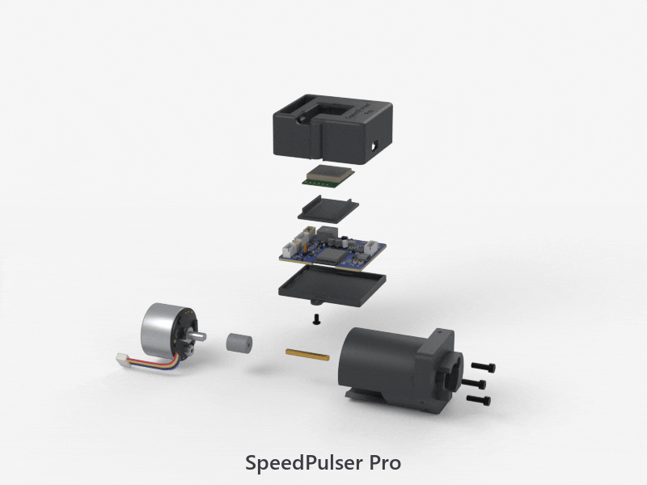

| Part | Notes |
|---|---|
| Control box | The S3 PCB in a printed lid and base, held by one M3 × 6 screw into an M3 insert at the lug |
| GPS window | On GPS units the module sits under the window in the lid (patch antenna facing up), held by a printed holder; units without GPS get a clip-in blanking cover |
| Motor in its speedo housing | Coupler pre-fitted to the motor shaft; the motor is held in the housing by 3 screws |
| Brass drive shaft | Square brass rod. **Not fitted when shipped.** Supplied long: trim to suit your cluster |
| Securing pins | Two, for housings that have the cross holes in the flange |
| Spare coupler | Couplers are 3D printed |

**The motor** is a TY3816B 12 V outrunner BLDC motor with its own driver board on the back: 37.4 mm can, 6 mm D shaft. The leads on the motor itself are red (+), white (FG, motor feedback), yellow (direction), black (GND) and blue (PWM).

**GPS blanking cover** (units without GPS): push the cover in from the top until both hooks click; it sits flush with the lid. To remove it, put a small flat screwdriver into the notch at the edge of the window away from the SMA slot, slide it under the lip and lever it up.

The PDF Installation Guide on GitHub has full step-by-step fitting instructions as well.

---

## Installation

### Installation Video

[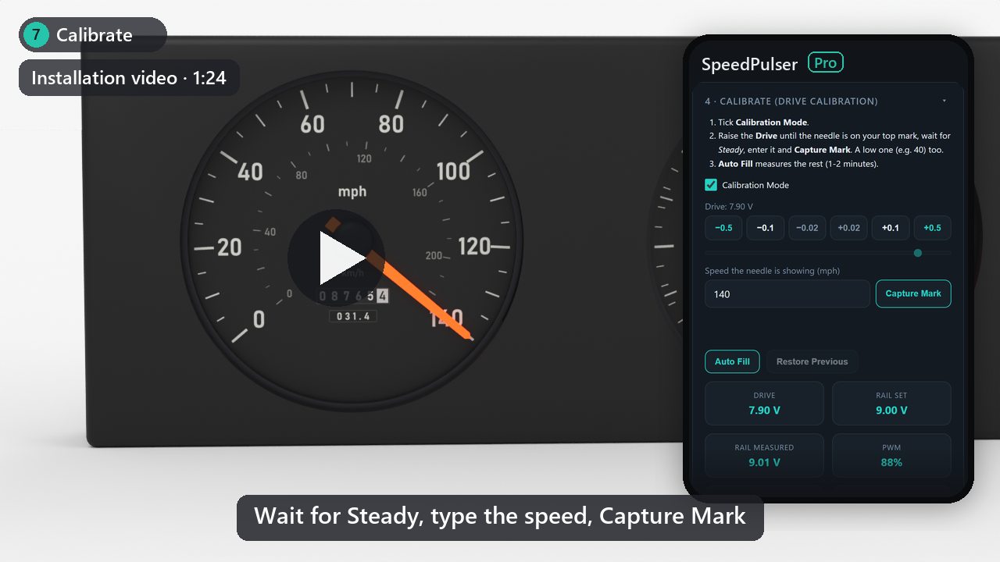](/Images/installation-video.mp4)

About a minute and a half, start to finish: stripping the motor out of its housing (the drive shaft isn't fitted when shipped), fitting and lining up the shaft, refitting the motor and securing it on the cluster; then wiring (with what every wire does), choosing the speed source and GPS update rate, calibration, and setting up the tacho with RPM Test.

### Wiring

The PCB carries three plug-in connectors along its edge plus a 4-pin GPS header:

- **Power / RPM Output** — 3-pin (silkscreen `12v GND MK2RPM`)
- **Motor** — 5-pin (silkscreen `MOTOR`)
- **Inputs / CAN** — 4-pin (silkscreen `RPM Speed CANH CANL`)
- **GPS** — 4-pin pin header (below the ESP32)

**Power / RPM Output** — the three-pin **`12v GND MK2RPM`** connector takes 12 V power and provides the coil-style RPM tacho output:

| Pin | Signal | Notes |
|-----|--------|-------|
| 1 | MK2 RPM Out | Black — closest to the edge of the PCB; high-voltage RPM output to the tacho |
| 2 | GND | White — common ground |
| 3 | PWR_IN (12 V) | Red — closest to the 5-pin motor connector; connect to ignition-switched 12 V |

> **Note:** The RPM output is intended for clusters expecting a coil-style square wave (e.g. VW MK2 tachometer). Turn it on in **Setup → 3 Tacho (RPM)** (drive the tacho output).

> **Legacy clusters & needle jitter:** On some older cluster, the coil-style RPM output can induce a little jitter in the hall inputs due to poor grounding. Fitting a **~500 Ω resistor in series** with the RPM output largely reduces this.

> **Legacy (DevKit) board:** an on-board adjustable **LM2596S** buck converter steps the 12 V supply down to about 9 V for the motor, keeping its operating range and torque within spec across the whole dial; the trimmer sets the motor voltage. The S3 board sets the motor rail itself (see [Motor Voltage](#feedback--motor-voltage-s3)).

**Motor** — the five-pin **`MOTOR`** connector:

| Pin | Signal | Notes |
|-----|--------|-------|
| 1 | Motor Power | Black — S3: the motor rail the firmware sets (Minimum to Maximum rail); DevKit (legacy): 5–9 V set via the on-board trimmer |
| 2 | Motor Feedback | Motor feedback (FG), read for the feedback trim (S3) |
| 3 | Motor Direction | Green — pull to GND to reverse needle direction |
| 4 | Motor Ground | White — motor ground |
| 5 | Motor PWM | 10 kHz PWM from ESP32 (via NPN level-shifter to 4V) |

**Inputs / CAN** — the four-pin **`RPM Speed CANH CANL`** connector carries both square-wave inputs and the CAN bus:

| Pin | Signal | Notes |
|-----|--------|-------|
| 1 | RPM In | 12V square-wave RPM input (closest to the blue trimmer) |
| 2 | Speed In | 5V or 12V square-wave speed input (hall sensor or Can2Cluster) |
| 3 | CAN H | CAN bus high |
| 4 | CAN L | CAN bus low (closest to the 5-pin motor connector) |

**VR speed sensor** *(S3)* — a two-pin right-angle connector (`VR_IN`) between the motor and input connectors; its plug goes in through the hole in the side of the box. It takes the two wires of a variable-reluctance (VR) speed sensor, which the board's MAX9924 VR interface turns into clean pulses. Pick **VR** as the speed source in Setup → 2.

> **Pull-up / Pull-down jumper:** Different hall sensors require either a pull-up or pull-down resistor. The 2-way jumper marked *SpeedPulser* selects this. If incoming pulses aren't being registered, swap the jumper position. Sensors with an internal resistor can have the jumper removed entirely.

> **CAN termination (`r-term`):** A 120 Ω terminating resistor for the CAN bus is selected by the `r-term` jumper. Leave it fitted if the SpeedPulser Pro is the only device on the bus. Remove it if the bus is already terminated elsewhere.

**GPS** — the four-pin GPS header takes any 3.3 V u-blox-compatible NMEA module (e.g. NEO-6M / NEO-M8N):

| Pin | Signal | Notes |
|-----|--------|-------|
| 1 | 3.3 V | Powered from the ESP32 on-board 3.3 V rail |
| 2 | RX | GPS RX — connect to GPS module TX |
| 3 | TX | GPS TX — connect to GPS module RX |
| 4 | GND | Ground |

The GPS is driven via the ESP32 hardware UART for clean reception at high update rates.

### Fitting the Drive Shaft

The drive shaft is not fitted when the unit ships, so the motor comes out of its housing once:

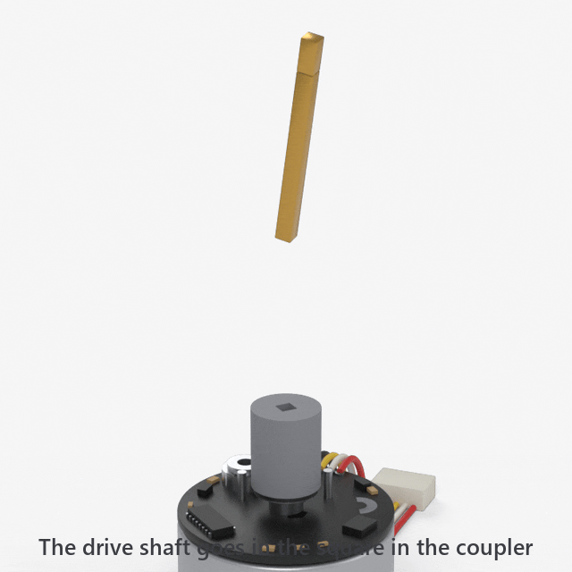

1. Undo the 3 screws and slide the motor out of the speedo housing.
2. Push the brass drive shaft into the square in the coupler, lined up straight. It's a tight fit: a few light taps will seat it.
3. Spin the motor by hand: the shaft must run true. Couplers are 3D printed, so slight misalignment is normal; gentle heat (≤ 100 °C) on the coupler lets you straighten it. If vibration ever loosens the coupler, a drop of superglue fixes it for good. Make sure it runs true before the glue sets.
4. Refit the motor with its wires out through the slot in the housing, and refit the 3 screws.
5. Check the shaft length against the cluster: it must engage the speedo drive but not bottom out and stop the housing seating fully. Trim it to suit, typically flush with the nose of the housing.
6. Push the housing straight on to the cluster's speedo spigot until it seats against the speedo plate, turning it slightly if the shaft needs to find the square in the speedo drive. Where your housing has them, push the two securing pins through the cross holes in its flange: they sit either side of the spigot and lock into its groove.

A spare coupler is in the box.

### Fitting to the Cluster

Once the housing is on the cluster, check:

- the drive shaft engages cleanly
- the motor spins freely by hand
- the housing seats fully

Take your time here: good fitment keeps noise down and makes the coupler last.

> Every motor / housing / cluster pairing wears in slightly differently. **DevKit (legacy) board:** expect to revisit the on-board potentiometer once after a few hours of running so the top end still reaches full scale cleanly. **S3 board:** check the top of the dial with Speed Test and re-capture the top mark if needed.

---

## Setup (WiFi & Web Interface)

Connect to the **`SpeedPulserPro`** WiFi access point (open network) and open **`192.168.1.1`** or **`speedpulserpro.local`** in a browser.

The interface is a single-page app served from the ESP32's LittleFS partition, in Forbes Automotive's dark theme. Settings apply straight away and are saved every 5 seconds; every value shown is the one the unit actually kept (a value it limits or refuses snaps back). The header shows the firmware version, what the unit is doing (**Running / Speed Test / RPM Test / Calibration Mode**), whether CAN frames are arriving, and what drives the needle (**Cal:**). Current firmware version: **5.09**.

One codebase, two boards: the **S3 board** (buck voltage control, motor feedback, VR input, input bias) and the **DevKit board** (fixed supply set by its pot, PWM duty only). The page shows only the parts the board has.

Five tabs, in the order a unit is set up:

| Tab | What's on it |
|---|---|
| **Dashboard** | Live speed (km/h), needle target (dial units), RPM, motor speed (S3), motor drive or duty, where the speed comes from, CAN and GPS state, and a chart: the live control trace (S3) or the active calibration curve (DevKit) |
| **Setup** | Seven numbered cards, top to bottom: **1 Board**, **2 Cluster & Speed Source**, **3 Tacho (RPM)**, **4 Calibrate**, **5 Check with Speed Test / RPM Test**, **6 Fine-tune** (speed offset), **7 Needle Sweep** |
| **Advanced** | Feedback and Motor Voltage (S3), Broadcast Speed on CAN, GPS Update Rate, CAN Analyser (SavvyCAN), Export / Import, Display Options (dial gauges, per browser) |
| **Diagnostics** | Every speed and RPM input side by side, with the one in use highlighted; offset, needle target, motor duty, drive, rail, motor feedback and trim; the Test Board steps (S3) |
| **OTA** | Firmware and web UI updates (see [Over-the-Air Updates](#over-the-air-updates)) |

Cards open and close by tapping their heading and remember it per browser.

<p align="center">
  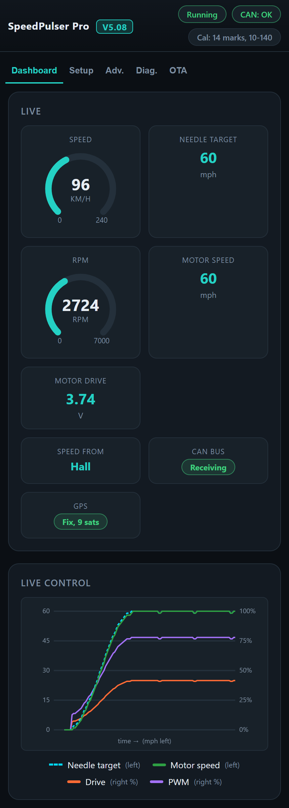
  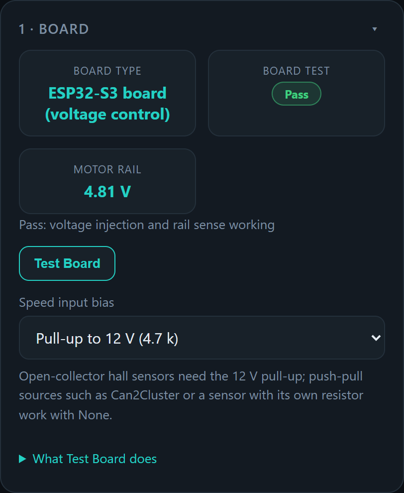
</p>

### Setup, step by step

**1 · Board** — the board type. On the **S3** run **Test Board** once (12 V+ supply): it stops the motor, steps the rail to 5, 7.5 and 10 V and reads each back, proving the voltage injection and the rail sense, and stores this board's own voltage line. The S3 also sets the **speed input bias**: the 12 V pull-up for an open-collector hall sensor, or none for a push-pull source such as Can2Cluster.

**2 · Cluster & Speed Source**

| Setting | What it does |
|---|---|
| The dial reads mph | The speed (km/h) is converted to mph for the needle. Drive marks are captured in the dial's unit, so changing it on a calibrated S3 asks first |
| Speed comes from | Hall, VR (S3), ECU, ABS, DSG (calculated from RPM + gear), DSG over TP2.0, DSG over UDS, GPS or a Custom CAN frame. Only one is used; the settings for the one picked appear under it |
| Hall / VR pulses per km | How many pulses the sensor gives per km. VW / Audi gearbox senders: **3600** (1 Hz = 1 km/h). 4,000 / 8,000 / 16,000 pulses-per-mile sensors are in the list; anything else: pulses per mile ÷ 1.609. The card shows the Hz this means at 100 km/h and at Maximum speed |
| Custom CAN | 11-bit ID (hex), low / high byte, byte order, scale and offset: km/h = raw × scale + offset |
| DSG | Gear ratios, final drives and tyre circumference (defaults DQ250 02E) |
| Maximum speed (km/h) | The fastest the needle is ever driven. A faster reading is held as a spike for 0.5 s, then the needle parks at Maximum speed |
| Smoothing (ms) | The hall / VR speed is averaged over at least this long: longer = steadier, shorter = quicker. Default 200 ms |
| Reverse motor direction | Flips the motor. Only changes with the motor stopped |

CAN, GPS, TP2.0 and UDS speeds drop to 0 when they stop updating (V5.06), so a lost source parks the needle instead of freezing it.

**3 · Tacho (RPM)** — drive the tacho output (ignition-coil type), RPM from the **RPM input pin** (passed to the tacho 1:1 in Hz) or **CAN** (scaled so *full scale RPM* gives *full scale Hz*), and the RPM smoothing (median of 1-10 samples).

**4 · Calibrate** — *S3*: **Drive Calibration** with **Auto Fill** (below). *DevKit*: pick the cluster **preset**, or build your own with the **Calibration Builder** and pick **★ Custom**.

**5 · Check with Speed Test / RPM Test** — the needle (or the tacho) follows the slider instead of the input; the card shows the needle target. Speed Test and Calibration Mode can't both be on: switching one on switches the other off. Neither is saved, so the unit always starts in normal running.

**Setting up the tacho:** tick *Drive the tacho output* (card 3), then tick **RPM Test** (card 5) and set it to 3000. If the tacho doesn't sit on 3, adjust **Tacho full scale (Hz)** until it does, check it higher up (e.g. 6000), then untick RPM Test. Test RPM and CAN RPM share that scaling, so a tacho that reads true on RPM Test reads true from CAN. RPM from the input pin is passed to the tacho 1:1 and needs no scaling.

<p align="center">
  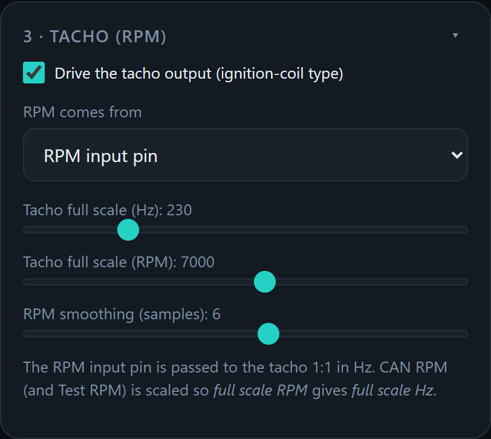
  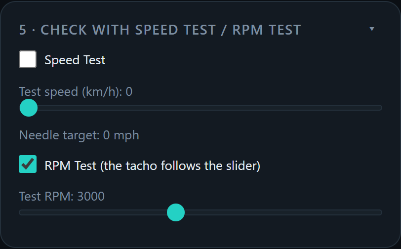
</p>

**6 · Fine-tune (Speed Offset)** — a fixed offset (−50…+50 km/h), or a different offset at 25 / 75 / 125 / 175 / 225 km/h (±20 each) with straight lines between them, so the needle never jumps as the speed changes. Applied while moving only.

**7 · Needle Sweep** — sweep both needles at power-up, the pace (ms per dial km/h or mph) and each needle's rate, and a Test Sweep button (only with the car stopped). The speed needle moves evenly from the lowest to the highest calibrated speed: the sweep ramps the speed, not the drive, and looks up the drive for each step through the calibration, so the motor's uneven response doesn't show. It slows to a stop at the top, waits until the motor has arrived (S3 motor feedback) or 0.4 s, and comes back the same way. The tacho needle follows the same profile from 0 to Max RPM. No calibration: only the tacho sweeps.

<p align="center">
  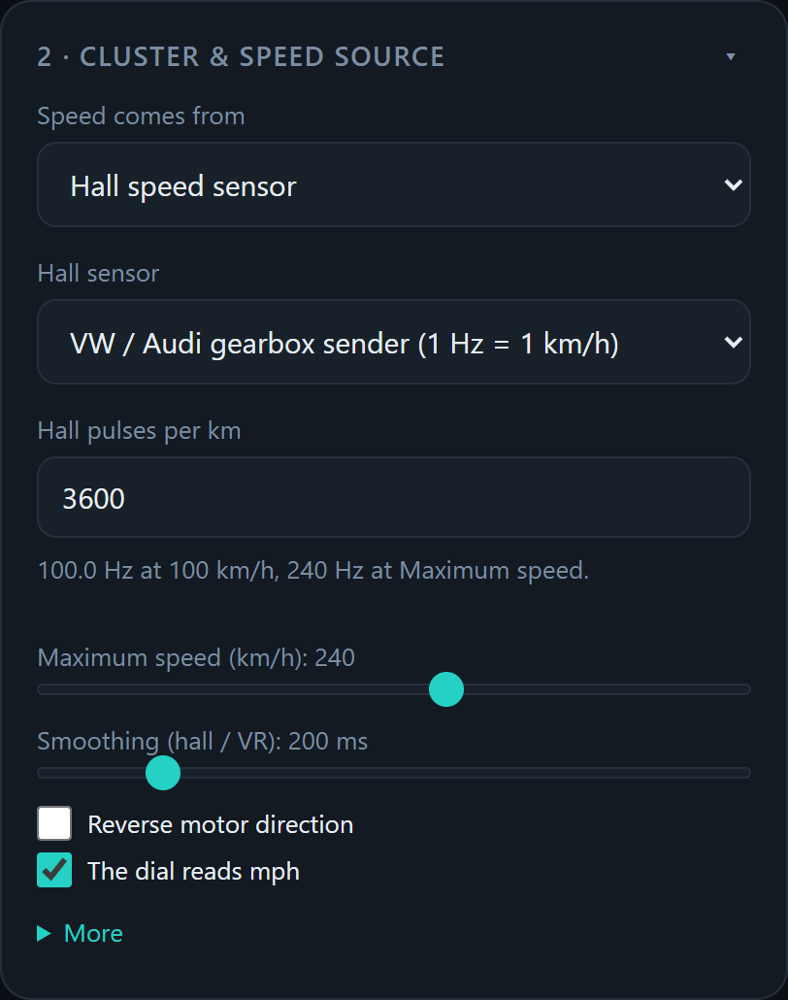
  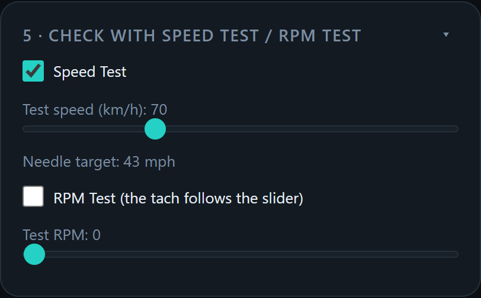
</p>

---

## Calibration

### Drive Calibration *(S3)*

1. Tick **Calibration Mode**. The motor starts stopped.
2. Raise the **Drive** (the −0.5 … +0.5 buttons; the bar under them only shows the drive, and the unit raises it at most 0.5 V per press) until the needle sits exactly on your **top mark** — the highest speed the needle should ever show (nothing runs past it) — wait for **Steady**, type the speed and press **Capture Mark**. A low mark by eye too (e.g. 40) makes the low end closer.
3. Press **Auto Fill** (needs the motor feedback). The motor works through the dial on its own, lowest speed first, in 1-2 minutes. It keeps every eye mark's speed and feedback Hz, re-measures its drive, and adds **auto** marks (10, 20, 30, 40, then every 10 to the top mark, wider if the 20 marks run out) on the straight line through the eye marks, finding the drive that holds each mark's feedback Hz. It never runs faster than the top mark or with more drive than 1.25 × the top mark's, and stops the motor if anything looks wrong. The table it replaces is saved: **Restore Previous** swaps back (and again).
4. Check with Speed Test. If a speed is off, put the needle on it and capture it: a mark set by eye always wins and replaces the auto marks that disagree with it.

Until the first mark is captured the motor doesn't move outside Calibration Mode. Marks can only be changed, cleared, restored or imported in Calibration Mode, so nothing jumps the needle while driving. Only the eye marks need a person: the dial (feedback Hz → needle) is a straight line only you can see, while the motor (drive → Hz) bends at the bottom but the motor feedback measures it.

<p align="center">
  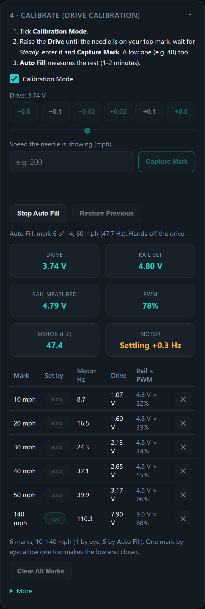
  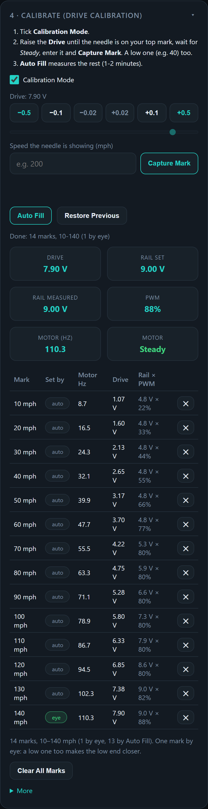
</p>

### Calibration Builder *(DevKit)*

1. Tick **Calibration Mode**, go to maximum duty (the −50 jumps from 0 straight to 4095) and set the pot so the needle reads the cluster's top speed.
2. Step the duty with −50 … +50 until the needle sits on a speed mark, pick that speed and press **Capture**. A point whose duty doesn't rise with its speed is refused (between such points the duty would run the wrong way).
3. Repeat across the dial, name it and press **Save & Use**: the points are saved and it runs as **★ Custom** in the preset list. Builder changes need Calibration Mode and never touch the running preset unless ★ Custom is the one selected.

<p align="center">
  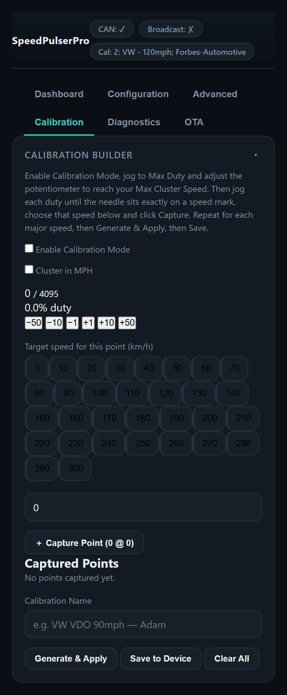
</p>

### Export / Import *(Advanced tab)*

**Export Calibration** saves the drive marks (S3, with the drive settings they were captured with) or the Calibration Builder points (DevKit); **Export as Firmware Preset** writes a paste-ready `motorPerformanceN[]` table. Each file says which kind it is, and **Import File** loads whichever kind it is — the whole file is checked first, and nothing changes if it doesn't fit.

<p align="center">
  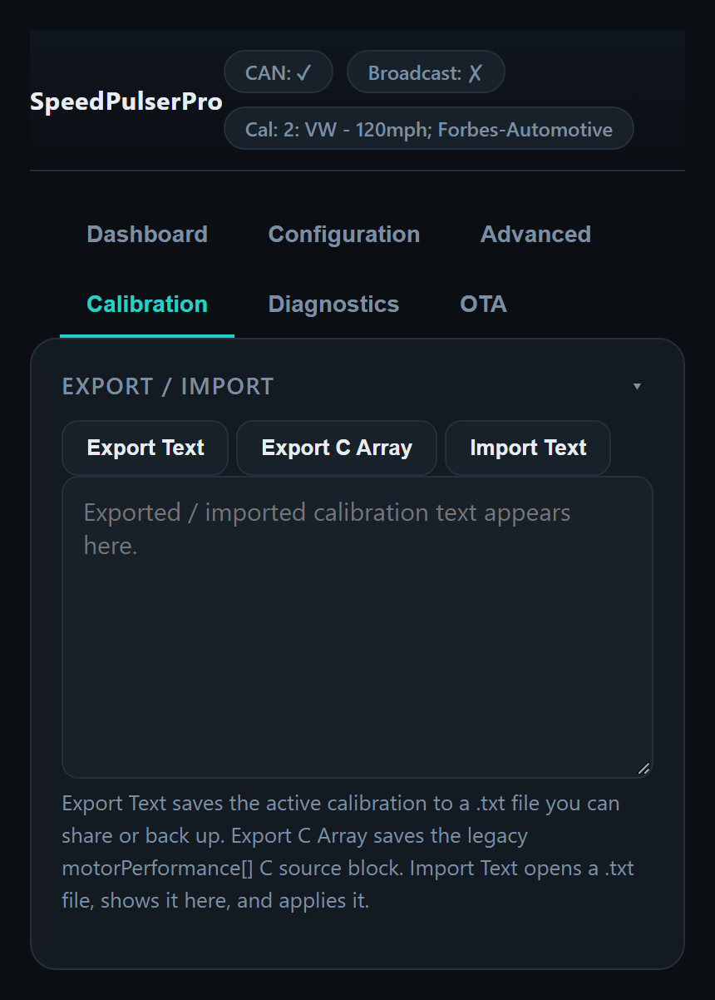
</p>

---

## GPS & Update Rates

The GPS module is driven via the ESP32 hardware UART for reliable reception. SpeedPulser Pro supports user-selectable update rates of **1 Hz, 5 Hz, 10 Hz and 16 Hz**, sent to the module as u-blox UBX rate commands. The selected rate is stored in EEPROM and survives reboots.

### How It Works

1. On boot, the firmware probes the GPS at 9600 baud and 38400 baud and locks onto whichever yields valid checksum-passing NMEA. The u-blox module always boots at 9600, so a re-flash without power-cycling the GPS is handled cleanly.
2. The GPS is left at its boot baud (9600) until satellite lock is acquired.
3. Once satellites are stable for ~20 seconds, the firmware automatically applies the stored update rate. If a rate of 5 Hz or higher is requested, it first issues a `PUBX,41` command to step the module up to 38400 baud (1 Hz uses 9600).
4. The user can also force the rate at any time from the **GPS Update Rate** card on the Advanced tab (it shows the countdown to the automatic apply); the live *GPS Updates/sec* counter confirms what's actually arriving.

### Choosing a Rate

| Rate | When to use |
|---|---|
| 1 Hz | Default; lowest UART load; suitable for casual / cruise display |
| 5 Hz | Smoother needle response in normal driving |
| 10 Hz | Track / spirited driving; very responsive |
| 16 Hz | Maximum responsiveness; some u-blox modules require 38400 baud |

> The update-rate change is blocking on the UART, so the main loop briefly suspends background tasks while the PUBX command is sent — this prevents the CAN RX, speed ISR and AsyncTCP tasks from corrupting the outgoing serial bytes.

<p align="center">
  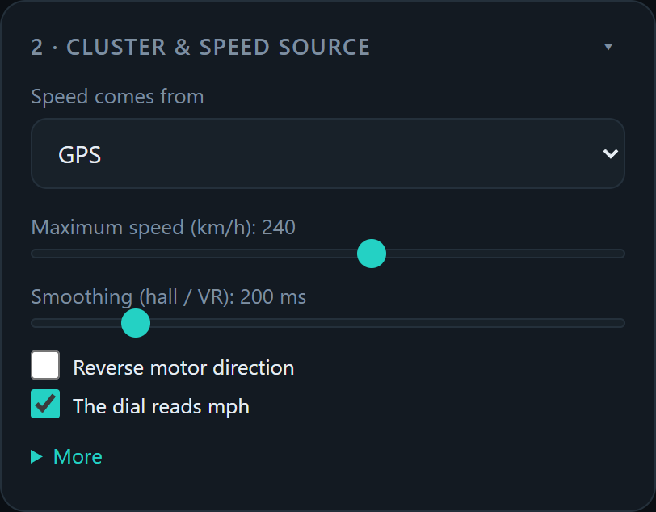
  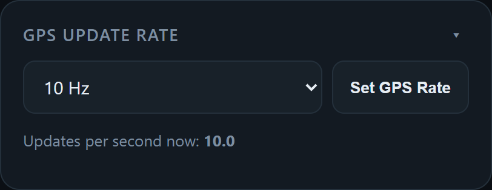
</p>

---

## CAN Bus

The SpeedPulser Pro runs the ESP32 TWAI controller at **500 kbit/s** with all-pass filtering, so any frame on the bus is available to the firmware.

### Built-in Decoders

| Source | Frames used | Output |
|---|---|---|
| ECU (VAG) | `MOTOR1` engine RPM, `MOTOR2` speed, `MOTOR5/6` EML/EPC/park | `vehicleRPMCAN`, `ecuSpeed` |
| ABS (VAG) | `BRAKES3` wheel-derived speed | `absSpeed` |
| DSG / Gear lever | `mWaehlhebel_1`, `gearLever` | Selected gear, reverse flag |
| DSG (TP2.0) | Channel setup → speed PID | `tp20Speed` |
| Generic | UDS read (0x22) speed PID | `udsSpeed` |
| Custom CAN | User-defined 11-bit ID + byte layout | `aftermarketSpeed` |

Pick the source on **Setup → 2 Cluster & Speed Source**. Each CAN speed reads 0 if its frame stops for 0.5 s, and the controller restarts itself after a bus-off.

### Broadcasting Speed

The final processed speed (after offset / MPH conversion) can be re-emitted onto CAN for downstream devices (e.g. cluster mods, head units). Configure the CAN ID, DLC, low/high byte indices, endianness, scale, offset and any template bytes from the **Broadcast Speed** card.

### SavvyCAN Forwarding

Every received frame can be forwarded to **SavvyCAN** for live capture:

- **WiFi mode** — GVRET protocol on TCP port `192.168.4.1:23`.
- **Serial mode** — GVRET protocol on USB-CDC.

The two modes are mutually exclusive and are switched on the **CAN Analyser** card (Advanced tab).

<p align="center">
  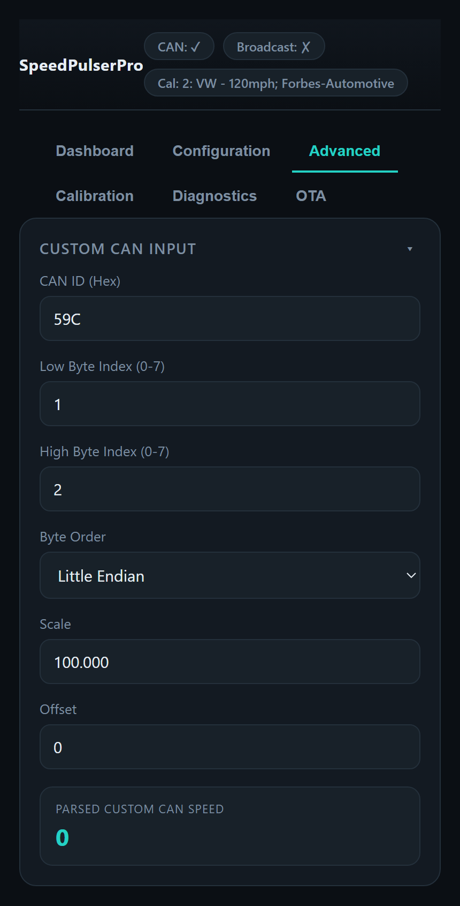
  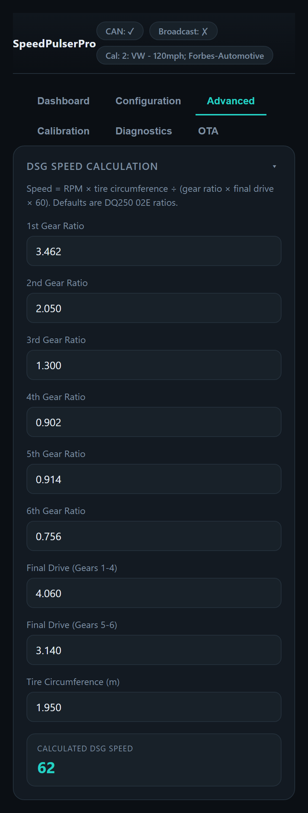
  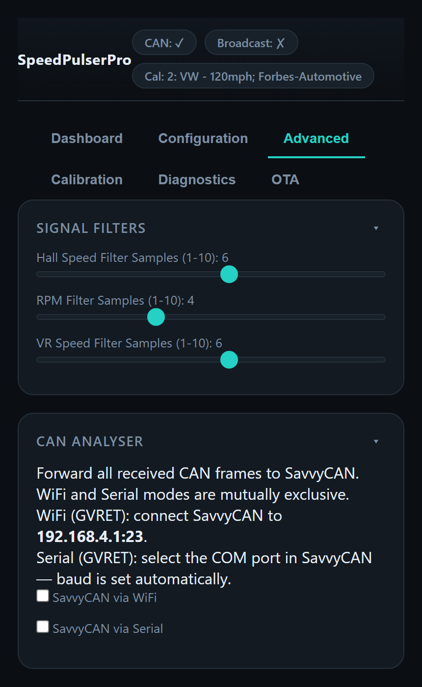
</p>

---

## Speed Offset

Set on **Setup → 6 Fine-tune**. The offset is added to the speed (in km/h) before the mph conversion, and only while moving.

**Fixed offset** (default) — one signed value, −50 … +50 km/h, across the whole range. Useful for a systematic bias from motor preload or cluster wear.

**Different offset at different speeds** — five offsets (±20 km/h each) at **25, 75, 125, 175 and 225 km/h**, with straight lines between them (flat below 25 and above 225), so the needle never jumps as the speed crosses a band. For clusters whose error changes across the dial.

---

## Over-the-Air Updates

Everything happens on the **OTA** tab; USB is only needed for the very first install, or if the web interface is ever lost.

- **Update from GitHub** — press **Check for updates**. The page reads the release list from [`adamforbes92/speedPulserPro`](https://github.com/adamforbes92/speedPulserPro) (`Releases/releases.json` plus the `V…` folders), shows *Installed* vs. *Latest* (older and beta releases sit behind a tick-box, for rolling back), then installs the selected version in six tracked steps: download and flash the web UI, verify it, download and flash the firmware, reboot. The browser needs internet *while it can still reach the controller* — join the controller to your router in the **Home WiFi (Bridge Mode)** card, put the phone on the same network and open the address the card shows (`http://speedpulserpro.local/` works there too). On the controller's own access point alone most phones drop mobile data.
- **Home WiFi (Bridge Mode)** — the controller joins a home or garage network as a station alongside its own access point. Scan or type the network name, save, and once it shows *Connected* the controller is reachable from that network as well. It tries hard for 20 s after boot, then once every 5 minutes, so a saved network can't disturb the access point when the car is parked away from home.
- **Update from Files** — no internet needed: download `littlefs.bin` and `firmware.bin` from the newest `Releases/V…/` folder and upload them here, **Filesystem** (web UI) first, then **Firmware**. The device reboots after the firmware.

Every upload is size-checked, and a filesystem image is verified by mounting it before the device reports success — a failed filesystem upload is wiped rather than left half-written. If the web interface is ever missing (a filesystem update that stopped part-way), the controller serves a **recovery page** at its address with the same two uploads and partition diagnostics, so it is never a USB job. Web assets are served `no-cache`, so a new UI is never hidden behind a stale copy in the phone's browser. `GET /api/ota/info` reports the firmware and web UI versions shown at the top of the tab; `GET /api/ota/check` gates updates on the device being in a safe state.

<p align="center">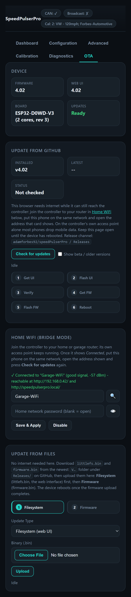</p>

---

## Feedback & Motor Voltage *(S3)*

Both are on the Advanced tab.

With **Hold the calibrated motor speed** on, one slow loop nudges the calibrated drive to hold the motor speed captured for each mark, against load and temperature drift. It works above **Off below** (dial units) and outside the **Deadband**, can never move the drive more than **Trim limit**, nor more than 5 % past the top mark; **Trim gain** sets how quickly it acts. The trim compares the measured motor speed with where the motor *should* be by now (a new target is followed with the motor's own ~0.35 s lag), so a speed change is left to the calibration and doesn't overshoot. Bench-tuned defaults: on, gain **2.0**, limit **±40 %**, deadband **0.3 Hz**, off below **8**; **Reset Feedback Defaults** loads them.

The DevKit has no motor feedback wired, so V5.06 removed the old PID loop (Kp / Ki / Kd) and its settings.

**Motor feedback measurement.** The motor gives 5 feedback (FG) pulses per revolution. The firmware times the pulses and averages whole revolutions, with a 1 ms filter for line noise, so the reading holds steady down to the motor's slowest speed (~6 Hz).

**Motor Voltage**: the motor is driven with one **drive** value, rail volts × PWM. At the low end the rail holds at **Minimum rail** (default 4.8 V: the motor's driver runs smoothly and restarts reliably from about 4.75 V) and the PWM falls to zero; above Minimum rail × **Nominal PWM** the PWM stays at Nominal and the rail rises, up to **Maximum rail**. Changing these after calibrating moves the needle: run Auto Fill again. The S3 always runs this way (V5.06 removed the "Voltage Control off" setting, which was never meant for the S3).

<p align="center">
  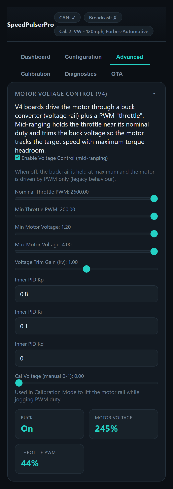
  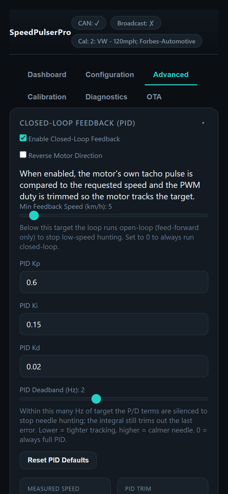
  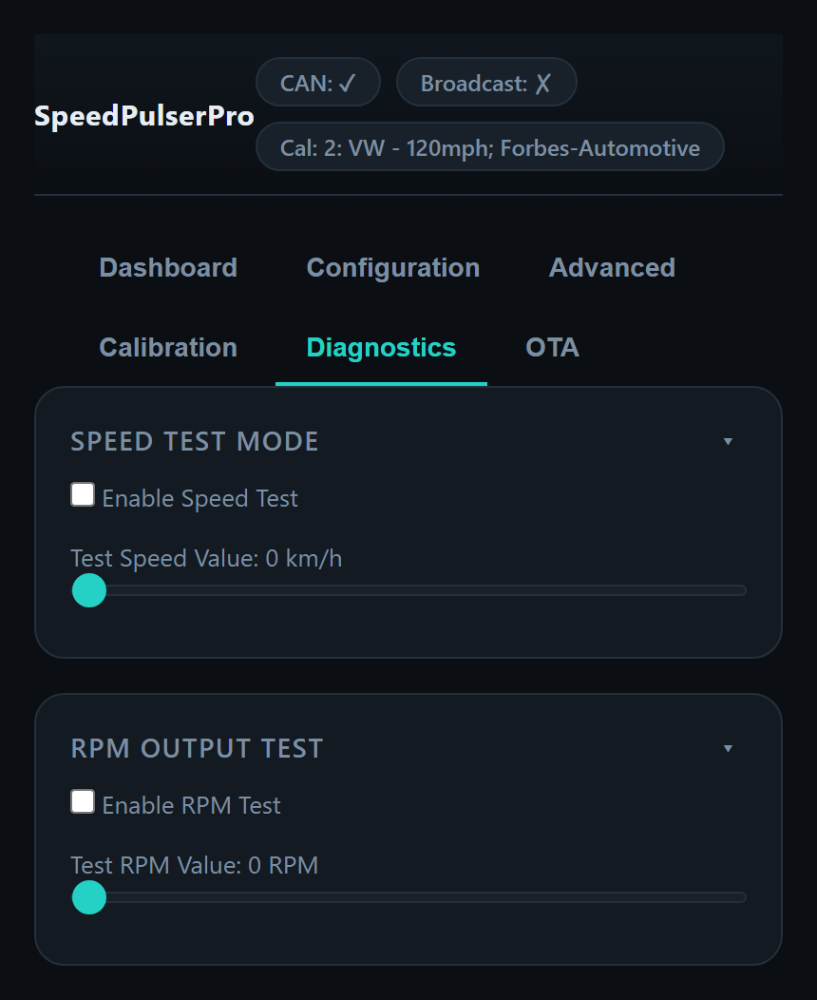
</p>

---

## How Calibration Works

### Signal Processing

```
Hall / VR pulse (falling edge)
    │
    ▼  interrupt: keeps the time of the last 64 pulses. A pulse closer to the last
    │  one than half a period at Maximum speed is noise (ignition EMI) and is dropped
    ▼
    frequency = pulses ÷ time, over at least the Smoothing time (or the 64 pulses).
    No pulse for a while: the reading falls smoothly; 0 after 1.5 s.
    km/h = Hz × 3600 ÷ pulses per km
    │
    │   ECU / ABS / DSG / TP2.0 / UDS / GPS / Custom CAN arrive in km/h
    │   (each drops to 0 when it stops updating)
    ▼  taskProcessSpeed()
    the selected source; above Maximum speed: held for 0.5 s, then parked at Maximum speed
    │
    ▼  toNeedleTarget()
    + offset (global, or the 5-point curve, interpolated) → × 0.621371 if the dial
    reads mph → rounded once → needle target (dial units)
    │
    ▼  S3:     drive calibration (+ feedback trim) → rail + PWM, every 100 ms
       DevKit: preset / custom table → 12-bit PWM duty, 10 kHz
```

A faster sensor just needs its pulses per km: the glitch filter follows it (e.g. 16,000 pulses per mile is ~550 Hz at 200 km/h, filter 0.9 ms). Settings from older firmware carry over: the old Max Hall (or VR) Frequency / Max Speed pair becomes pulses per km = 3600 × Hz ÷ km/h, and the old offset + "positive" tick becomes one signed offset.

The RPM input still uses a windowed average with a median of *RPM smoothing* samples, and its glitch filter is half a period at the tacho's full scale.

> [!NOTE]
> **Lowest speed shown:** each legacy calibration array has a lowest speed the motor can hold (the default array starts at 24 km/h). At or below it the motor is switched off and the needle rests on zero. On the S3, a drive calibration that includes a low mark reaches much slower speeds.

### The Legacy Calibration Array *(DevKit)*

Each calibration profile is a **386-element `uint16_t` array** stored in flash (`PROGMEM`). The **array index** represents speed in km/h (0–385) and the **array value** is the 10-bit PWM duty cycle (0–1023) that drives the motor to produce the corresponding reading on that cluster.

```
index   0  →  duty   0   (motor off / dead band)
index  50  →  duty  ~60  (motor at ~50 km/h cluster reading)
index 120  →  duty ~130  (motor at ~120 km/h cluster reading)
  ...
index 200  →  duty ~195  (motor at full scale for a 200 km/h cluster)
```

Values near index 0 are `0` — the motor's dead band where it will not yet turn. Values plateau near the top because the cluster needle is at full deflection.

> The Calibration Builder now supports a larger duty range and finer control is now available.  Legacy speed arrays are already produced so cannot be revisited.  Building your own may yield better results!

### Reading a Legacy Calibration Array

To check what duty a profile produces at a given speed, index directly:

```cpp
// Direct lookup — returns the 10-bit duty for 80 km/h on the active profile
uint16_t duty = motorPerformance[80];
```

`findClosestMatch()` does the inverse: given a target speed value, it walks the array to find the entry whose **value** is closest to the target and returns the **index** as the duty cycle. This gracefully handles calibration arrays that are not perfectly monotone.

---

## Power Management

The firmware includes a **universal reduced-power manager** (`power_manager` — also used in SpeedPulser and Can2Cluster) that activates automatically 1 minute after the last WiFi client disconnects. This cuts current through the on-board linear regulator, directly reducing its heat output — important for long ignition-on times.

**What changes when idle:**

| Action | Saving |
|---|---|
| WiFi radio off | ~80–120 mA average (single biggest saving) |
| CPU: 240 MHz → 80 MHz | Moderate reduction in active current |
| Bluetooth controller released at boot | ~60 KB RAM freed; small idle current saving |
| WiFi modem-sleep while clients are connected | Minor saving without losing connectivity |
| Reduced WiFi TX power | Adequate for in-car range; further small saving |
| Onboard LED off at boot | Tiny but persistent saving |

**Waking back up:**  
As soon as a device reconnects to the WiFi AP, full power is restored automatically — the radio comes back up, the CPU returns to 240 MHz, and the web server resumes. A power-cycle (ignition off/on) will also restore WiFi.

> The ESP32 DevKit V1 (WROOM-32) and the ESP32-S3 run at 240 MHz; the power manager auto-detects this at compile time and adjusts accordingly. On ESP32-C3 / S2 variants the active clock caps at 160 MHz.

---

## Technical Reference

### Pin Assignments (ESP32 DevKit V1, legacy board)

| GPIO | Function |
|---|---|
| 2  | Onboard LED |
| 13 | GPS TX (ESP → module RX) |
| 14 | GPS RX (ESP ← module TX) |
| 16 | TWAI / CAN TX |
| 17 | TWAI / CAN RX |
| 18 | RPM hall input (falling-edge interrupt) |
| 19 | Motor Direction |
| 21 | Motor PWM output (LEDC, stepped to 5 V via NPN transistor) |
| 22 | Coil-style RPM output (hardware timer) |
| 23 | Motor Feedback |
| 26 | Speed hall input (falling-edge interrupt) |

The S3 board's pins are defined in `include/SpeedPulserPro_board.h` (`SPP_BOARD_S3`).

### PWM Parameters

| Parameter | Value |
|---|---|
| Frequency | 10 kHz |
| Resolution | 12-bit (0–4095); the presets are 10-bit tables, interpolated |
| Driver | Native ESP-IDF `ledc_set_duty` / `ledc_update_duty` |

### CAN / TWAI

| Parameter | Value |
|---|---|
| Baud | 500 kbit/s |
| Mode | Normal, accept-all filter |
| RX queue | 256 frames |
| TX queue | 16 frames |

### FreeRTOS Tasks

| Task | Purpose |
|---|---|
| `taskCANRx` | TWAI receive + decoder + SavvyCAN forwarder |
| `taskWriteEEP` | Persist Preferences (5 000 ms; test modes are never saved) |
| `taskUpdateUI` | Push live values to the web UI (200 ms) |
| `taskParseGPS` | Continuous TinyGPS++ parse |
| `taskParseDSG` | DSG / gear ratio decode |
| `taskProcessSpeed` | Hall / VR timing, source selection, offset, S3 drive control / DevKit duty lookup |
| `taskProcessRPM` | RPM source selection and output drive |
| `taskBroadcastSpeed` | Periodic CAN broadcast of final speed |
| `taskTP20` / `taskUDS` | Transport-protocol speed pollers |

### PlatformIO Dependencies

| Library | Purpose |
|---|---|
| `mathieucarbou/ESPAsyncWebServer` | Async web server (ESP-IDF 5.x compatible fork) |
| `mathieucarbou/AsyncTCP` | Underlying TCP for AsyncWebServer |
| `bblanchon/ArduinoJson` | JSON serialisation for REST API |
| `RobTillaart/RunningMedian` | Median filter for RPM smoothing |
| `mikalhart/TinyGPSPlus` | NMEA parsing |

Platform: `pioarduino/platform-espressif32` 54.03.20 (Arduino-ESP32 3.x / ESP-IDF 5.x)

---

## Disclaimer

The SpeedPulser Pro drives an analog speedometer for display purposes. It should always be assumed that the reading is approximate — Forbes Automotive accepts no responsibility for any speed-related incident arising from its use.

---

## Version History

| Version | Summary |
|---|---|
| V1.01 | Initial release — used SpeedPulser and Can2Cluster as a base |
| V1.02 | Confirmed WiFi and RPM working |
| V1.03 | Board revision — EasyEDA, ground planes, separate Speed / RPM pull-to-ground inputs, ECU RPM repurposed pin |
| V1.04 | "Cannot find" speed → set to zero; low-speed fixes |
| V1.05 | Hall-type RPM in WiFi UI; on-the-fly calibration changes; read EEP at startup |
| V1.06 | New calibrations; removed `setTxPower` (caused WiFi drop on speed change) |
| V1.07 | Speed-input selection in WiFi; UI tidy-up |
| V1.08 | Calibration page |
| V2.00 | PlatformIO port; UDS support for DSG speed reading |
| V2.01 | GPS speed reading; CAN speed broadcasting; configurable & persistent GPS update rate |
| V2.10 | Linearised needle sweep; Tara 120 mph calibration |
| V2.20 | SavvyCAN analyzer; "Cluster in MPH" conversion option |
| V2.30 | RPM / speed task pacing tuned so GPS has room to update |
| V2.40 | GPS moved to hardware `HardwareSerial` UART for faster, cleaner reception |
| V2.50 | Universal power-management module (WiFi-off + CPU scaling after 1 min idle); GPS auto-baud probe on boot; GPS update-rate auto-apply after satellite stability |
| V3.00 | Closed-loop motor feedback (PID) — measures the motor feedback and trims PWM duty so the needle holds under load |
| V3.01 | Live calibration-curve graph on the Dashboard (duty-vs-speed trace + achieved-point marker); Dashboard mirrors the standard SpeedPulser (Motor Duty / Measured Speed / PID Trim) |
| V3.02 | Live Sweep Speed slider; needle sweep rewritten to drive both needles to full deflection over a bounded time with independent Speed/RPM ramp rates (drops the Linearise control); shared `ota_manager` OTA module + reworked OTA tab; three-state GPS status; Speed Test Mode moved to the Diagnostics tab |
| V3.03 | Custom calibrations now remember the cluster unit they were captured in and the device auto-enables "Cluster in MPH" whenever an MPH cal becomes the active calibration |
| V3.04 | Closed-loop feedback is sense-check for legacy PCBs without the motor-feedback circuit |
| V4.00.0 | Voltage-control hardware support (VR input) |
| V4.01.0 | Adopted Forbes Automotive's shared Ignitron dark theme, Wi‑Fi AP/mDNS manager (`speedpulserpro.local`) and the two-step `ota_manager` firmware/filesystem OTA module, common across the ESP32 product line |
| V4.02 | OTA overhaul: uploads that complete, verified filesystem updates with a recovery page, "Update from GitHub" and a Home WiFi (bridge mode) card |
| V5.00 | ESP32-S3 board (rev6): one codebase for DevKit and S3, buck voltage control with Test Board, VR speed input, switchable speed-input bias |
| V5.01 | S3 drive calibration: up to 10 captured marks set the motor drive (rail x PWM), with an optional gentle feedback trim; voltage calibration export / import |
| V5.02 | RPM input passes through to the tacho 1:1 (was ~30 RPM low); fractional-Hz RPM output; glitch filter scaled per input, so 6/8-cyl RPM above 333 Hz no longer reads half; RPM Filter Samples = 1 no longer outputs 0 RPM |
| V5.03 | Picking a speed source switches the others off (Custom CAN left TP2.0 on), and the page always shows the source really in use; a speed above Max Speed for 0.5 s parks the needle at Max Speed instead of 0; the Positive Offset tick now saves across restarts |
| V5.04 | MQB DSG speed over UDS corrected (shared DSG speed code, ported from the Can2Cluster firmware reverse-engineering): reads DID `0x100A` "Vehicle speed from transmission" on the DSG's own IDs `0x7E1/0x7E9`, 16-bit little-endian signed, km/h = raw/10, replacing a placeholder (`0x0101`, /100). PQ DSG speed (TP2.0, raw/3) confirmed correct and unchanged |
| V5.05 | Motor side brought level with SpeedPulser V5.05: motor feedback read from pulse timing on every board (no 0 Hz dropouts below ~20 Hz); S3: Minimum Rail setting (default 4.8 V), overshoot-free feedback trim with bench-tuned defaults, Drive Calibration **Auto Fill** (top mark by eye, the rest measured; eye / auto marks, up to 20, Restore Previous), display-only drive bar with a 0.5 V step guard |
| V5.06 | Audit pass, mirroring SpeedPulser V5.06. **Web page** rebuilt as numbered Setup steps (Board, Cluster & Speed Source, Tacho, Calibrate, Test, Offset, Needle Sweep) with only the selected source's settings shown. **Speed input:** hall / VR set by pulses per km (presets for 4,000 / 8,000 / 16,000 pulses per mile), glitch filter follows Max Speed, pulse timing averaged over a Smoothing time; one signed offset, offset curve interpolated. **Sources:** CAN, GPS, TP2.0 and UDS speeds drop to 0 when they stop updating (they used to freeze the needle); CAN bus-off recovery; DSG speed uses the RPM from the selected input. **Safety:** an uncalibrated S3 no longer drives the motor; every setting range-checked (a large tacho Hz stalled the chip); Speed Test and Calibration Mode exclude each other and are never saved; cal tables saved crash-safe; web POSTs JSON only; OTA only with the car stopped. DevKit PID and the S3 "Voltage Control off" setting removed |
| V5.07 | Even needle sweep (mirrors SpeedPulser V5.07): the speed needle ramps through the calibration instead of the drive, slows to a stop at the top and waits for the motor; the tacho follows the same profile |
| V5.08 | Second audit pass (mirrors SpeedPulser V5.08): Calibration Builder no longer overwrites the running preset, Save & Use always saves; Auto Fill clears and rebuilds on screen, eye / auto switchable; Motor Voltage in Calibration Mode only, Maximum Rail default 8 V; test modes end when WiFi sleeps; the feedback trim drops out when the motor feedback is lost; rail over-voltage trip; GPS standstill cut-off and no needle freeze on GPS rate apply; CAN receive keeps up with a busy bus; OTA / WiFi cross-site check; orange test banner, offline badge, tidier UI |
| V5.09 | One web page (app.js) shared with SpeedPulser, same setting names; start-up log; CAN broadcast sends the real speed (not the test speed); DSG gear times out; TP2.0 / timer / interrupt fixes; tuning constants in `SpeedPulserPro_config.h`; drive tables range-checked and saved straight away; main loop no longer spins a core at 100 %; library versions pinned; rev-counter labels say Tacho (were Tach) |
